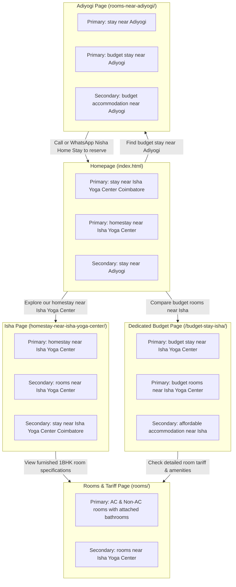

# Nisha Home Stay – Primary Keyword SEO + AEO + GEO Audit

**Website:** [https://www.nishahomestay.com/](https://www.nishahomestay.com/)  
**Role:** Principal SEO Architect, Senior Technical SEO Engineer, Local SEO Specialist, AEO/GEO Strategist  
**Date:** 14 November 2026  
**Document Location:** `docs/PRIMARY_KEYWORD_SEO_AUDIT.md`  

---

## 1. Executive Summary & Audit Overview

A comprehensive site-wide audit was conducted across all pages (`index.html`, `homestay-near-isha-yoga-center/index.html`, `rooms-near-adiyogi/index.html`, `rooms/index.html`, `location/index.html`, `404.html`), SEO metadata, JSON-LD structured data graphs, heading hierarchies, image alt attributes, and contextual internal link structures.

The audit evaluated the presence, targeting, distribution, search intent alignment, and cannibalization risks for the **seven primary target keywords**:
1. `budget stay near Adiyogi`
2. `budget stay near Isha Yoga Center`
3. `budget rooms near Isha Yoga Center`
4. `stay near Isha Yoga Center Coimbatore`
5. `homestay near Isha Yoga Center`
6. `rooms near Isha Yoga Center`
7. `stay near Adiyogi`

### Global Keyword Occurrence Summary Table

| # | Target Keyword | Exact Count | Where Found | Current Targeting Status | Primary Deficiency |
|:---:|:---|:---:|:---|:---|:---|
| 1 | `budget stay near Adiyogi` | **0** | None | Absent site-wide | Not targeted in any title, H1, meta, or body text on `rooms-near-adiyogi/` |
| 2 | `budget stay near Isha Yoga Center` | **0** | None | Absent site-wide | Lacks dedicated page and natural search phrase integration |
| 3 | `budget rooms near Isha Yoga Center` | **1** | `index.html` (1) | Weak (single H2) | Missing in title, meta description, structured data, and dedicated page |
| 4 | `stay near Isha Yoga Center Coimbatore` | **0** | None | Absent as exact phrase | Split across fragmented clauses; missing in title, H1, and lead text |
| 5 | `homestay near Isha Yoga Center` | **12** | `index.html` (4), `homestay-near-isha/` (7), `404.html` (1) | Active | Core phrase present, but needs stronger AEO/FAQ and H1 harmonization |
| 6 | `rooms near Isha Yoga Center` | **5** | `index.html` (4), `rooms/` (1) | Under-optimized | Completely absent from `homestay-near-isha-yoga-center/` |
| 7 | `stay near Adiyogi` | **2** | `index.html` (2) | Inverted targeting | Absent from target page `rooms-near-adiyogi/index.html` entirely |

---

## 2. In-Depth Keyword-by-Keyword Analysis

### 2.1 Keyword 1: `budget stay near Adiyogi`
* **Exact Occurrences:** 0
* **Current Page Targeting:** Intended for `/rooms-near-adiyogi/`, but currently completely absent from the page.
* **Target Page Existing Title:** `Rooms Near Adiyogi Shiva Statue | Nisha Home Stay Coimbatore` (58 chars)
* **Target Page Meta Description:** `Looking for clean, affordable rooms near Adiyogi? Nisha Home Stay in Semmedu offers AC & Non-AC 1BHK rooms with attached bathrooms. Call +91 63813 97636 to book.` (163 chars)
* **Target Page Existing H1:** `Comfortable Rooms Near Adiyogi Shiva Statue, Coimbatore`
* **Target Page Existing H2s:**
  * `Relax Close to Adiyogi Without City Travel Fatigue`
  * `Transparent Room Rates Near Adiyogi`
  * `Frequently Asked Questions About Staying Near Adiyogi`
  * `Ready to Book Your Rooms Near Adiyogi?`
* **Current Content Relevance:** The page discusses distance (2.2 km / 10 mins) and room rates from ₹1,500, but fails to use the high-intent query phrase `budget stay near Adiyogi`.
* **Internal Link Opportunities:**
  * Homepage pricing and nearby attraction cards can link contextually using "Find a budget stay near Adiyogi".
  * Rooms page comparison table can link to Adiyogi page with budget stay anchor text.
* **Missing Optimization Opportunities:**
  * Update Meta Title: Include "Budget Stay Near Adiyogi".
  * Update Meta Description: Naturally integrate `budget stay near Adiyogi`.
  * Add dedicated FAQ: "Where can I find a budget stay near Adiyogi?"
  * Update hero lead and intro paragraph to include this phrase.
* **Cannibalization Risks:** Low risk. Ensuring this query is exclusively primary on `rooms-near-adiyogi/` prevents conflict with Isha-specific pages.

---

### 2.2 Keyword 2: `budget stay near Isha Yoga Center`
* **Exact Occurrences:** 0
* **Current Page Targeting:** None. Neither `index.html` nor `homestay-near-isha-yoga-center/` currently uses this phrase.
* **Current Content Relevance:** Nisha Home Stay's tariff begins at ₹1,500 for a furnished 1BHK unit (up to 7 guests), representing genuine budget value compared to city hotels and premium resorts. However, no page currently serves the search intent of users specifically searching for budget stays near Isha.
* **Dedicated Page Opportunity (`/budget-stay-isha/`):**
  * Creating a dedicated, high-quality, comprehensive landing page `/budget-stay-isha/` satisfies the intent of spiritual pilgrims, meditators, and budget travelers comparing affordable lodging near Isha Foundation.
  * Avoids diluting the serene retreat branding of `homestay-near-isha-yoga-center/`.
* **Internal Link Opportunities:**
  * Homepage section "Budget Rooms Near Isha Yoga Center" can link directly to `/budget-stay-isha/`.
  * `homestay-near-isha-yoga-center/` tariff section can link contextually.
  * Global navigation/footer links can surface the budget guide.
* **Missing Optimization Opportunities:**
  * Create `/budget-stay-isha/` with targeted title, meta description, H1, H2s, structured data, and FAQs.
  * Integrate secondary references naturally in `index.html` and `homestay-near-isha-yoga-center/`.
* **Cannibalization Risks:** Medium risk if not carefully mapped. `homestay-near-isha-yoga-center/` focuses on peace, atmosphere, and homestay experience; `/budget-stay-isha/` focuses on tariffs, inclusions, cost transparency, and budget traveler tips.

---

### 2.3 Keyword 3: `budget rooms near Isha Yoga Center`
* **Exact Occurrences:** 1 (in `index.html` line 560 as an H2: `Budget Rooms Near Isha Yoga Center`).
* **Current Page Targeting:** Shared between `index.html` and the upcoming `/budget-stay-isha/`.
* **Homepage Title:** `Homestay Near Isha Yoga Center & Adiyogi | Nisha Home Stay`
* **Homepage Meta Description:** `Looking for a stay near Isha Yoga Center? Nisha Home Stay in Semmedu offers AC and Non-AC rooms with attached bathrooms. Call +91 63813 97636 for availability.`
* **Current Content Relevance:** The homepage features a room tariff card under this H2, but the surrounding body text does not naturally reiterate the keyword or provide deep AEO answers.
* **Internal Link Opportunities:**
  * Anchor from the homepage H2 block directly to the detailed budget page.
  * Contextual link from `rooms/` tariff comparison section.
* **Missing Optimization Opportunities:**
  * Add FAQ in both HTML accordion and JSON-LD FAQPage: "Are budget rooms available near Isha Yoga Center?"
  * Reinforce in `/budget-stay-isha/` H2 and introductory copy.
  * Optimize room image alt text: "Furnished budget rooms near Isha Yoga Center with attached bathroom".
* **Cannibalization Risks:** Low risk when mapped as primary to `/budget-stay-isha/` and secondary to `index.html`.

---

### 2.4 Keyword 4: `stay near Isha Yoga Center Coimbatore`
* **Exact Occurrences:** 0
* **Current Page Targeting:** Intended as Primary for `index.html` (Homepage) and Secondary for `homestay-near-isha-yoga-center/`.
* **Current Title & H1 Status:**
  * Homepage Title: Has "Homestay Near Isha Yoga Center & Adiyogi | Nisha Home Stay" (missing "Coimbatore").
  * Homepage H1: `Homestay near Isha Yoga Center` (missing "stay near Isha Yoga Center Coimbatore").
* **Current Content Relevance:** The site mentions "stay" and "Coimbatore" repeatedly, but never binds the complete high-intent local query together: `stay near Isha Yoga Center Coimbatore`.
* **Internal Link Opportunities:**
  * Subpages (`location/`, `rooms/`, `homestay-near-isha-yoga-center/`) can link back to the homepage using variations of this anchor text.
  * Breadcrumb root anchors to homepage.
* **Missing Optimization Opportunities:**
  * Homepage H1 Optimization: E.g., `Affordable Homestay & Stay Near Isha Yoga Center Coimbatore`.
  * Homepage Meta Description Optimization: Integrate exact phrase seamlessly.
  * Introductory paragraph: "Looking for a peaceful, comfortable stay near Isha Yoga Center Coimbatore? Nisha Home Stay offers..."
  * FAQ optimization: "Where can I find a peaceful stay near Isha Yoga Center Coimbatore?"
* **Cannibalization Risks:** Zero risk. Homepage owns the broad geographic brand + entity intent (`Coimbatore`).

---

### 2.5 Keyword 5: `homestay near Isha Yoga Center`
* **Exact Occurrences:** 12
  * `index.html`: 4 occurrences (Title, H1, H2, FAQ)
  * `homestay-near-isha-yoga-center/index.html`: 7 occurrences (Title, Meta, H1, Lead, Summary, FAQ)
  * `404.html`: 1 occurrence (Quick link)
* **Current Page Targeting:** Primary for `homestay-near-isha-yoga-center/index.html`; Co-primary for `index.html`.
* **Target Page Existing Title:** `Homestay Near Isha Yoga Center | Nisha Home Stay Semmedu` (54 chars)
* **Target Page Existing Meta Description:** `Book a peaceful homestay near Isha Yoga Center (~1.8 km, 8 mins). Nisha Home Stay in Semmedu offers furnished AC & Non-AC 1BHK rooms with attached bathrooms. Call +91 63813 97636.` (176 chars - slightly long, optimal is 140–160 chars)
* **Target Page Existing H1:** `Peaceful Homestay Near Isha Yoga Center, Coimbatore`
* **Current Content Relevance:** Extremely strong. This is currently the best-targeted keyword on the site.
* **Internal Link Opportunities:**
  * Homepage contextual link: "Explore our homestay near Isha Yoga Center."
  * `location/` and `rooms/` cross-linking.
* **Missing Optimization Opportunities:**
  * Tighten meta description to exactly 155 characters for optimal SERP display without truncation.
  * Add explicit AEO FAQ: "Where can I find a homestay near Isha Yoga Center in Coimbatore?"
  * Elevate in structured data WebPage `about` and `mainEntity` descriptions.
* **Cannibalization Risks:** Homepage and `homestay-near-isha-yoga-center/` currently compete slightly. By differentiating Homepage as the broad overview (`stay near Isha Yoga Center Coimbatore`) and the subpage as the dedicated deep-dive homestay experience, both rank cleanly without cannibalization.

---

### 2.6 Keyword 6: `rooms near Isha Yoga Center`
* **Exact Occurrences:** 5
  * `index.html`: 4 occurrences
  * `rooms/index.html`: 1 occurrence
  * `homestay-near-isha-yoga-center/index.html`: **0 occurrences!**
* **Current Page Targeting:** Currently under-represented on the dedicated Isha page (`homestay-near-isha-yoga-center/`) and only once on `rooms/`.
* **Current Content Relevance:** Visitors seeking individual "rooms" or "room booking" near Isha need clear reassurance that Nisha Home Stay provides furnished 1BHK AC and Non-AC rooms with attached bathrooms.
* **Internal Link Opportunities:**
  * Contextual link from `homestay-near-isha-yoga-center/` to `rooms/`: "View our furnished rooms near Isha Yoga Center".
  * Link from homepage feature section.
* **Missing Optimization Opportunities:**
  * Add to `homestay-near-isha-yoga-center/index.html` H2 and copy: "Furnished AC & Non-AC Rooms Near Isha Yoga Center".
  * Add FAQ: "How can I book rooms near Isha Yoga Center?"
  * Optimize room photo alt tags on `rooms/` and `homestay-near-isha-yoga-center/`.
* **Cannibalization Risks:** Low risk. `rooms/index.html` focuses on technical room specifications (1BHK dimensions, geyser, kitchen, 1–7 guest capacity), while `homestay-near-isha-yoga-center/` focuses on booking rooms for Isha visitors.

---

### 2.7 Keyword 7: `stay near Adiyogi`
* **Exact Occurrences:** 2 (both in `index.html` lines 333 & 432).
  * `rooms-near-adiyogi/index.html`: **0 occurrences!**
* **Current Page Targeting:** Paradoxically absent from `rooms-near-adiyogi/index.html`, where it should be the primary keyword!
* **Target Page Existing Title:** `Rooms Near Adiyogi Shiva Statue | Nisha Home Stay Coimbatore`
* **Target Page Existing H1:** `Comfortable Rooms Near Adiyogi Shiva Statue, Coimbatore`
* **Current Content Relevance:** `rooms-near-adiyogi/` emphasizes the 10-minute drive to the Adiyogi statue and the 7:00 PM Divya Darshanam laser show, making it the perfect landing page for `stay near Adiyogi`.
* **Internal Link Opportunities:**
  * Homepage section: "Find comfortable, affordable stay near Adiyogi."
  * Isha page nearby places: "Stay near Adiyogi for the evening laser show."
* **Missing Optimization Opportunities:**
  * Update Title: `Stay Near Adiyogi & Budget Rooms | Nisha Home Stay` (or similar, 55–60 chars).
  * Update H1: `Comfortable Stay Near Adiyogi Shiva Statue, Coimbatore`.
  * Update Meta Description: Integrate both `stay near Adiyogi` and `budget stay near Adiyogi`.
  * Add FAQ: "Where can I find a comfortable stay near Adiyogi?"
* **Cannibalization Risks:** Currently inverted (present on homepage, missing on Adiyogi page). Correcting `rooms-near-adiyogi/` to be the primary target resolves this completely.

---

## 3. Current Page-Level Metadata & Heading Inventory

| Page File | Current Canonical URL | Current Title (Chars) | Current Meta Description (Chars) | Current H1 |
|:---|:---|:---|:---|:---|
| `index.html` | `https://www.nishahomestay.com/` | `Homestay Near Isha Yoga Center & Adiyogi \| Nisha Home Stay` (60) | `Looking for a stay near Isha Yoga Center? Nisha Home Stay in Semmedu offers AC and Non-AC rooms with attached bathrooms. Call +91 63813 97636 for availability.` (163) | `Homestay near Isha Yoga Center` |
| `homestay-near-isha-yoga-center/index.html` | `https://www.nishahomestay.com/homestay-near-isha-yoga-center/` | `Homestay Near Isha Yoga Center \| Nisha Home Stay Semmedu` (56) | `Book a peaceful homestay near Isha Yoga Center (~1.8 km, 8 mins). Nisha Home Stay in Semmedu offers furnished AC & Non-AC 1BHK rooms with attached bathrooms. Call +91 63813 97636.` (176) | `Peaceful Homestay Near Isha Yoga Center, Coimbatore` |
| `rooms-near-adiyogi/index.html` | `https://www.nishahomestay.com/rooms-near-adiyogi/` | `Rooms Near Adiyogi Shiva Statue \| Nisha Home Stay Coimbatore` (58) | `Looking for clean, affordable rooms near Adiyogi? Nisha Home Stay in Semmedu offers AC & Non-AC 1BHK rooms with attached bathrooms. Call +91 63813 97636 to book.` (163) | `Comfortable Rooms Near Adiyogi Shiva Statue, Coimbatore` |
| `rooms/index.html` | `https://www.nishahomestay.com/rooms/` | `AC & Non-AC Rooms with Attached Bathrooms \| Nisha Home Stay` (58) | `Explore furnished AC and Non-AC 1BHK rooms at Nisha Home Stay, Semmedu. Attached bathrooms, Wi-Fi, kitchen access & space for up to 7 guests. Call +91 63813 97636.` (166) | `Furnished AC & Non-AC Rooms With Private Attached Bathrooms` |
| `location/index.html` | `https://www.nishahomestay.com/location/` | `Location & Directions to Nisha Home Stay \| Semmedu, Coimbatore` (61) | `Get directions and travel details to Nisha Home Stay at 330/1 NGR Street, Semmedu. Located approximately 1.8 km (8 mins) from Isha Yoga Center. Call +91 63813 97636.` (163) | `Location & Directions to Nisha Home Stay, Semmedu` |
| `404.html` | N/A | `Page Not Found (404) \| Nisha Home Stay Semmedu` (46) | `The page you requested could not be found. Return to Nisha Home Stay homepage or call +91 63813 97636 for room bookings near Isha Yoga Center.` (145) | `404 Error` |

---

## 4. Strategic Keyword-to-Page Mapping Plan

To guarantee zero cannibalization, maximum search relevance, and clear intent fulfillment, the seven keywords are assigned as follows:

---

## 5. Architectural Decision: Dedicated Page `/budget-stay-isha/`

### Intent Evaluation:
* **The Query:** Users searching for `budget stay near Isha Yoga Center` and `budget rooms near Isha Yoga Center` are price-sensitive pilgrims, solo meditators, student groups, and families seeking low-cost, genuine accommodation without luxury markups.
* **Why an Existing Page Is Inadequate:**
  * `rooms/` is a technical inventory page detailing unit dimensions, AC/Non-AC specs, geyser, kitchen amenities, and capacity tiers (1 to 7 guests).
  * `homestay-near-isha-yoga-center/` is a tranquil atmosphere page focused on spiritual peace, mountain surroundings, and Isha program retreat vibes. Overburdening it with aggressive "budget" terminology dilutes its serene branding.
* **The Solution:** A dedicated, in-depth guide page at `/budget-stay-isha/`:
  * Focuses transparently on the **₹1,500 starting price** (subject to occupancy/booking conditions).
  * Details how families and groups save significantly with a full 1BHK unit vs. renting multiple hotel rooms.
  * Outlines budget inclusions (Wi-Fi, parking, hot water, kitchen access, clean mountain air, no surge commissions).
  * Provides honest comparisons with ashram dormitories and expensive city hotels 30 km away.
  * Contains dedicated Schema.org `LodgingBusiness`, `WebPage`, `BreadcrumbList`, and `FAQPage` JSON-LD graphs.
  * Passes all Core Web Vitals, mobile responsiveness, and zero-overflow tests.

---

## 6. Audit Sign-Off & Next Steps

This audit establishes the baseline facts across all 7 target keywords. With zero occurrences for 4 of the 7 keywords and inverted/under-optimized targeting for the remaining 3, this optimization plan provides an immediate, decisive enhancement to the website's organic visibility, local search discoverability, and AEO/GEO answer engine citation readiness.
